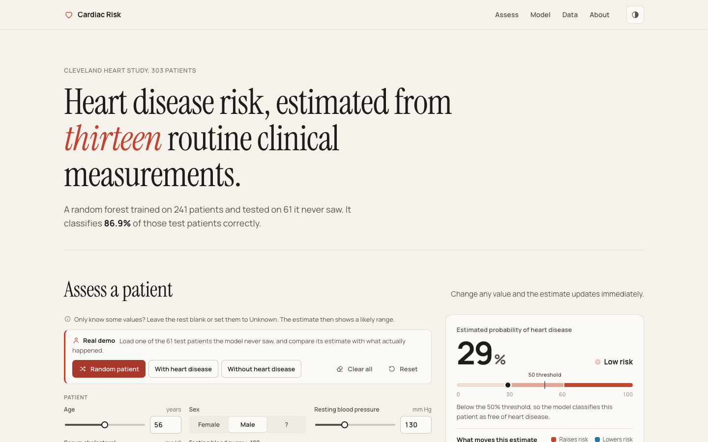
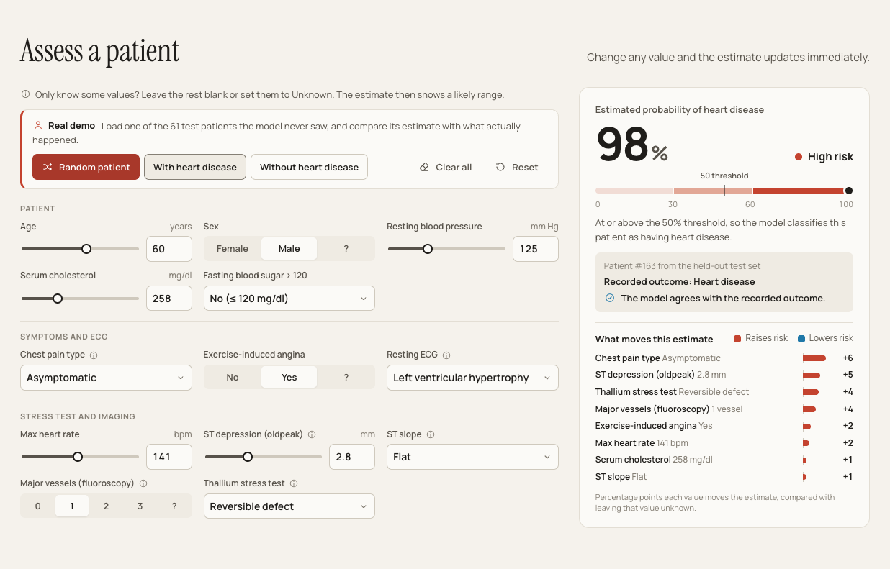
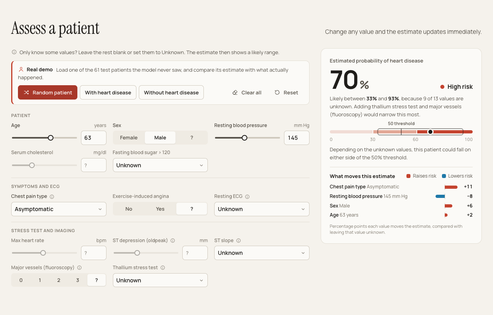
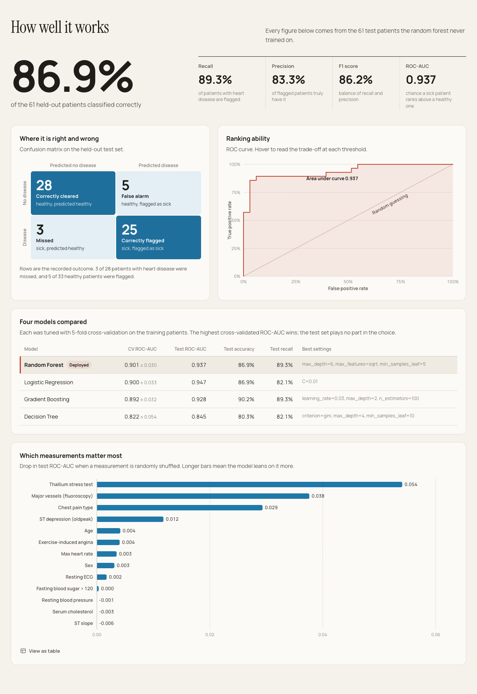
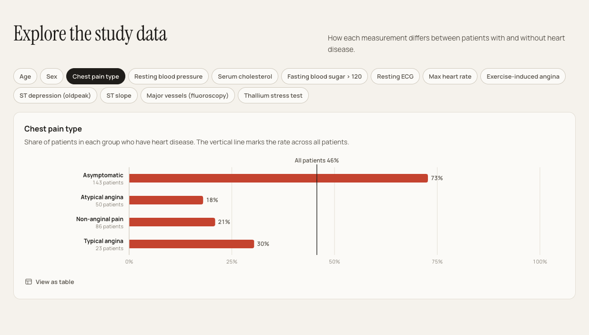
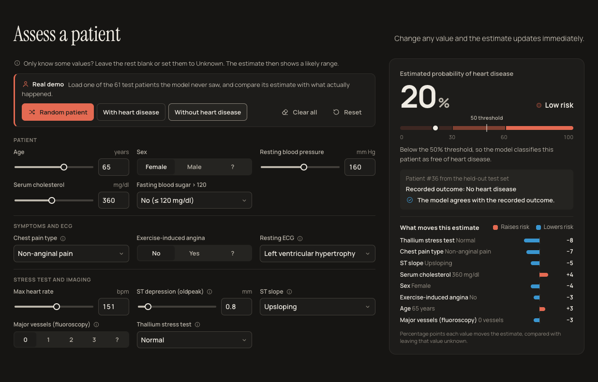
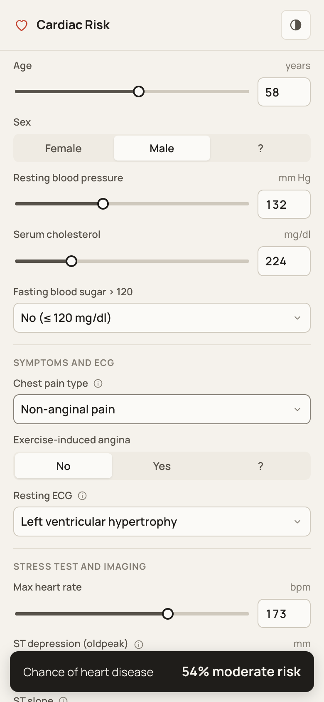

# Heart Disease Prediction

A machine learning project that estimates the probability that a patient has heart disease from
13 routine clinical measurements, served through an interactive web app called **Cardiac Risk**.

The model is a random forest trained on the UCI Cleveland heart disease study. On 61 patients it
never saw during training, it classifies **86.9%** correctly with a **ROC-AUC of 0.937** and
catches **89.3%** of patients who have heart disease. The app lets you enter a patient (or only
the values you know), see the estimate update live, understand what drives it, and check the
model against real patients whose outcome is known.



> For education only. This is not a medical device and must not be used for diagnosis.

## Contents

- [Features](#features)
- [Quick start](#quick-start)
- [Tech stack](#tech-stack)
- [The dataset](#the-dataset)
- [Data cleaning and label corrections](#data-cleaning-and-label-corrections)
- [Machine learning pipeline](#machine-learning-pipeline)
- [Results](#results)
- [How the app makes a prediction](#how-the-app-makes-a-prediction)
- [API reference](#api-reference)
- [Project structure](#project-structure)
- [What changed from the original notebook](#what-changed-from-the-original-notebook)
- [Limitations](#limitations)
- [Acknowledgements](#acknowledgements)

## Features

### Assess a patient, live

Enter the 13 measurements and the estimate updates as you type. The result panel shows the
probability, a Low / Moderate / High risk label, where the patient sits against the 50% decision
threshold, and how much each value moves the estimate. The whole form fits beside the result on
a laptop screen, so the estimate never scrolls out of view. Clinical terms have help tooltips.



### Real-patient demo

Three buttons load an actual patient from the 61 held-out test patients: a random one, one with
heart disease, or one without. The model never saw these patients during training, so the app
can honestly show the recorded outcome next to the model's call, including the roughly 13% of
cases where the model is wrong.

### Only know some values?

Leave any field blank or set it to Unknown, or press **Clear all** and enter only what you
have. The app fills the gaps from the most similar real patients and shows a likely range,
so the uncertainty is visible. It also tells you which missing test would narrow
the range most.



### Model performance report

Accuracy, recall, precision, F1 and ROC-AUC on the held-out test set, a labelled confusion
matrix, an interactive ROC curve, the comparison of all four candidate models, and permutation
feature importance.



### Data explorer

Every measurement split by outcome: histograms for numeric values and heart disease rates for
categories, each with a table view.



### Dark mode and mobile

The app follows the system colour scheme (with a manual toggle) and works on phones. On small
screens, a bar pinned to the bottom keeps the estimate visible while you fill in the form.

<p>
  
  
</p>

## Quick start

Requires **Python 3.11 or newer** (developed and tested on Python 3.14).

```bash
git clone https://github.com/kushal721/Heart-Attack-Prediction.git
cd Heart-Attack-Prediction

python3 -m venv .venv
source .venv/bin/activate          # Windows: .venv\Scripts\activate
pip install -r requirements.txt

python train.py                    # trains the model, about 30 seconds
python server.py                   # open http://localhost:8000
```

`train.py` prints the cross-validation and test scores of every candidate model and saves the
chosen one to `models/heart_model.joblib`. If that file is missing, `server.py` trains the model
itself on first launch. The `models/` folder is not committed because it is fully reproducible.

To follow the analysis step by step, open the notebook:

```bash
jupyter notebook Heart_attack_Pred.ipynb
```

## Tech stack

| Layer | Technology | Used for |
|---|---|---|
| Language | Python 3.11+ | Everything on the backend |
| Data | pandas 3.1, NumPy 2.5 | Loading, cleaning and reshaping the data |
| Machine learning | scikit-learn 1.9 | Preprocessing pipeline, models, cross-validation, metrics, permutation importance |
| Model storage | joblib | Saving the trained pipeline and its evaluation results |
| Web server | FastAPI, Uvicorn, Pydantic | JSON API with input validation, and serving the front end |
| Front end | HTML, CSS and JavaScript (no framework, no build step) | The whole interface |
| Charts | Hand-written SVG in JavaScript | ROC curve, histograms, bar charts, confusion matrix |
| Typography | Instrument Serif (headings), Manrope (text), bundled locally | Works offline, no external requests |
| Analysis | Jupyter, matplotlib, seaborn | The exploratory notebook |

The front end has no dependencies at all: the browser loads three files from `web/` and talks
to the API with `fetch`. Every chart, icon and control is drawn by the app itself.

## The dataset

The data is the **Cleveland Clinic heart disease study** (1988) from the UCI Machine Learning
Repository, in the re-encoded form that is widely shared on Kaggle. It has 303 patients and 13
measurements per patient.

| Column | Measurement | Type | Values |
|---|---|---|---|
| `age` | Age | Number | years |
| `sex` | Sex | Binary | 0 female, 1 male |
| `cp` | Chest pain type | Category | 0 asymptomatic, 1 atypical angina, 2 non-anginal pain, 3 typical angina |
| `trestbps` | Resting blood pressure | Number | mm Hg |
| `chol` | Serum cholesterol | Number | mg/dl |
| `fbs` | Fasting blood sugar above 120 mg/dl | Binary | 0 no, 1 yes |
| `restecg` | Resting ECG result | Category | 0 left ventricular hypertrophy, 1 normal, 2 ST-T wave abnormality |
| `thalach` | Maximum heart rate during exercise | Number | beats per minute |
| `exang` | Exercise-induced angina | Binary | 0 no, 1 yes |
| `oldpeak` | ST depression induced by exercise relative to rest | Number | mm |
| `slope` | Slope of the peak exercise ST segment | Category | 0 downsloping, 1 flat, 2 upsloping |
| `ca` | Major vessels coloured by fluoroscopy | Number | 0 to 3 (4 means missing) |
| `thal` | Thallium stress test result | Category | 1 fixed defect, 2 normal, 3 reversible defect (0 means missing) |
| `target` | Outcome | Binary | 1 no heart disease, 0 heart disease (see below) |

After cleaning: **302 unique patients**, of whom **138 (46%) have heart disease** and 164 do not.

## Data cleaning and label corrections

**Duplicates.** The file `data/heart.csv` has 1,125 rows, but only 302 unique patients. Every
patient appears several times, and some copies have a value blanked out. Incomplete copies are
dropped first and exact duplicates second, which leaves each patient exactly once. This matters:
with duplicates left in, copies of the same patient end up in both the training and the test
set, and the test score rewards memorising patients.

**The codes did not mean what the documentation says.** The value counts of every column match
the original UCI study exactly, but with a different code order. Matching the counts reveals the
true meaning of each code:

| Column | Count in the original UCI study | Count in this file | Conclusion |
|---|---|---|---|
| `target` | no disease 164, disease 139 | 1: 164, 0: 138 | `target = 1` means **no** heart disease |
| `cp` | typical 23, atypical 50, non-anginal 86, asymptomatic 144 | 0: 143, 1: 50, 2: 86, 3: 23 | 0 is asymptomatic, 3 is typical angina |
| `slope` | upsloping 142, flat 140, downsloping 21 | 0: 21, 1: 140, 2: 141 | 0 is downsloping, 2 is upsloping |
| `thal` | normal 166, fixed 18, reversible 117, missing 2 | 0: 2, 1: 18, 2: 165, 3: 117 | 2 is normal, 0 is missing |
| `ca` | 0 to 3, 4 missing | 4: 4 | 4 is missing |

The clinical picture confirms the `target` inversion. Patients with `target = 1` are younger
(52.6 vs 56.6 years), reach a higher maximum heart rate (158 vs 139 bpm), and have less ST
depression, less exercise-induced angina and fewer blocked vessels. That is the healthy group.
The model therefore predicts `disease = 1 - target`, and the missing-value placeholders
(`ca = 4`, `thal = 0`) are converted to real missing values and filled in by the pipeline.

## Machine learning pipeline

All of this lives in `heart_model.py`, shared by `train.py`, the notebook and the server, so
every part of the project trains and uses exactly the same model.

1. **Split.** 80/20 train/test split, stratified by outcome, fixed seed: 241 training patients,
   61 test patients. The test set is held back until the very end.
2. **Preprocessing** (a scikit-learn `Pipeline` with a `ColumnTransformer`, fit inside every
   cross-validation fold so it never sees validation data):
   - numeric and binary columns: fill missing values with the median, then standardise
   - categorical columns (`cp`, `restecg`, `slope`, `thal`): fill missing values with the most
     frequent value, then one-hot encode
3. **Model selection.** Four model types are each tuned with grid search and stratified 5-fold
   cross-validation on the training set, scored by ROC-AUC:

   | Model | Hyperparameters searched |
   |---|---|
   | Logistic regression | `C` in 0.01 to 3 |
   | Random forest (300 trees) | `max_depth`, `min_samples_leaf`, `max_features` |
   | Gradient boosting | `n_estimators`, `learning_rate`, `max_depth` |
   | Decision tree | `criterion`, `max_depth`, `min_samples_leaf` |

4. **Choice.** The model with the best cross-validated ROC-AUC wins. The test set plays no part
   in the choice.
5. **Final evaluation.** The winner is scored once on the 61 test patients. That exact model is
   the one the app uses, so the published numbers describe the deployed model and the test
   patients stay unseen for the demo.

**The selected model** is a `RandomForestClassifier` with 300 trees, `max_depth=6`,
`max_features="sqrt"`, `min_samples_leaf=5` and `random_state=42`. ROC-AUC was chosen as the
selection metric because it measures how well the model ranks sick patients above healthy ones,
independent of any single threshold.

## Results

All figures are on the 61 held-out test patients.

| Metric | Value | Meaning |
|---|---|---|
| Accuracy | 86.9% | Patients classified correctly |
| Recall (sensitivity) | 89.3% | Patients with heart disease that the model flags |
| Precision | 83.3% | Flagged patients who truly have heart disease |
| F1 score | 86.2% | Balance of recall and precision |
| ROC-AUC | 0.937 | Chance a random sick patient is ranked above a random healthy one |

**Confusion matrix**

| | Predicted no disease | Predicted disease |
|---|---|---|
| **No disease** (33) | 28 correctly cleared | 5 false alarms |
| **Disease** (28) | 3 missed | 25 correctly flagged |

**All four models**

| Model | CV ROC-AUC | Test ROC-AUC | Test accuracy | Test recall | Best settings |
|---|---|---|---|---|---|
| **Random forest (selected)** | **0.901** ± 0.030 | 0.937 | 86.9% | 89.3% | max_depth 6, max_features sqrt, min_samples_leaf 5 |
| Logistic regression | 0.900 ± 0.033 | 0.947 | 86.9% | 82.1% | C 0.01 |
| Gradient boosting | 0.892 ± 0.032 | 0.928 | 90.2% | 89.3% | learning_rate 0.03, max_depth 2, 100 trees |
| Decision tree | 0.822 ± 0.054 | 0.845 | 80.3% | 82.1% | gini, max_depth 4, min_samples_leaf 10 |

The top three models are within noise of each other: the cross-validation spread (± 0.03) is
larger than the gaps between them. Logistic regression even scores slightly higher on the test
set, but choosing a model by its test score would turn the test set into a second training set,
so the cross-validated winner is kept. A single decision tree is clearly weaker.

**Most important measurements** (drop in test ROC-AUC when a measurement is randomly shuffled):
thallium stress test 0.054, major vessels 0.038, chest pain type 0.029, ST depression 0.012.
Everything else contributes little on its own.

## How the app makes a prediction

**Complete input.** The 13 values go through the pipeline and the random forest returns a
probability. Patients at 50% or above are classified as having heart disease. The risk label
uses three bands: Low below 30%, Moderate from 30% to 60%, High from 60%.

**Partial input.** Unknown values are filled in from real patients. The app finds the 60
training patients most similar on the values you did enter (standardised distance for numbers,
mismatch count for categories), borrows their values for the unknown fields, and averages the
model's predictions over those 60 completions. Borrowing from similar patients keeps
combinations realistic: an older patient tends to come with a lower maximum heart rate. The 10th
to 90th percentile of those predictions is shown as the likely range, and the unknown fields
are listed by importance so you know which test would help most. Test patients are never used
to fill gaps.

The fewer values you know, the wider the range and the weaker the estimate. Measured by hiding
values from the 61 test patients:

| Known values | Test accuracy | Test ROC-AUC | Typical range width |
|---|---|---|---|
| All 13 | 86.9% | 0.937 | none |
| All except thallium test and major vessels | 82.0% | 0.885 | 32 points |
| No stress test or imaging | 77.0% | 0.806 | 58 points |
| Age, sex, blood pressure and cholesterol only | 59.0% | 0.649 | 71 points |

With only the basics, the model is barely better than guessing, and the wide range says so.

**What moves the estimate.** For each value you entered, the app recomputes the estimate as if
that value were unknown. The difference, in percentage points, is how much knowing that value
moves the estimate up (red) or down (blue).

## API reference

The server exposes a small JSON API, also browsable at `http://localhost:8000/docs`.

| Method | Path | Returns |
|---|---|---|
| `GET` | `/api/meta` | Model name and settings, test metrics, ROC curve, model comparison, feature importance, and the form definition |
| `POST` | `/api/predict` | Probability, likely range, risk band, classification and drivers for a patient |
| `GET` | `/api/demo-patient?outcome=0\|1` | A random real patient from the held-out test set with their recorded outcome |
| `GET` | `/api/explore/{feature}` | Distribution of one measurement by outcome |

`POST /api/predict` accepts any subset of the 13 fields, so leave out whatever is unknown.
Values are range-checked and invalid input returns HTTP 422.

```bash
curl -X POST http://localhost:8000/api/predict \
  -H "Content-Type: application/json" \
  -d '{"age": 63, "sex": 1, "cp": 0, "trestbps": 145}'
```

```json
{
  "probability": 0.704,
  "low": 0.333,
  "high": 0.935,
  "band": "high",
  "prediction": 1,
  "drivers": [
    {"feature": "cp", "label": "Chest pain type", "value": "Asymptomatic", "effect": 0.109},
    {"feature": "trestbps", "label": "Resting blood pressure", "value": "145 mm Hg", "effect": -0.078},
    {"feature": "sex", "label": "Sex", "value": "Male", "effect": 0.064},
    {"feature": "age", "label": "Age", "value": "63 years", "effect": 0.022}
  ],
  "unknown": [
    {"feature": "thal", "label": "Thallium stress test"},
    {"feature": "ca", "label": "Major vessels (fluoroscopy)"},
    {"feature": "oldpeak", "label": "ST depression (oldpeak)"}
  ]
}
```

(The `unknown` list is shortened here. It contains all 9 missing fields, most useful first.)

## Project structure

```
Heart-Attack-Prediction/
├── data/
│   └── heart.csv                Raw data: 1,125 rows, 302 unique patients
├── docs/
│   └── screenshots/             Images used in this README
├── web/
│   ├── index.html               Page structure
│   ├── styles.css               Design tokens, layout, light and dark themes
│   ├── app.js                   Form, live predictions, demo, SVG charts, tooltips
│   └── fonts/                   Instrument Serif and Manrope (SIL Open Font License)
├── heart_model.py               Data loading, label corrections, pipeline, training,
│                                partial-input estimation and explanations
├── train.py                     Trains the model and saves it to models/
├── server.py                    FastAPI app: JSON API and static front end
├── Heart_attack_Pred.ipynb      Step-by-step analysis notebook
├── Documentation.pdf            Original project write-up
├── requirements.txt
└── README.md
```

## What changed from the original notebook

The first version of this project was a single notebook with a decision tree at 72% accuracy.
The rebuild fixed several problems:

- The notebook loaded `Heart_attack_pred.csv`, but the file was named `.xls`, so it did not run.
- The reported confusion matrix and classification report came from the untuned model, and the
  tuned model was never evaluated on the test set.
- Grid search ran in a loop of ten with no random seed, so the "best" settings changed on every
  run, and cross-validation scores included the test patients.
- The `target` labels were inverted and the `cp`, `slope` and `thal` labels were wrong (see
  [above](#data-cleaning-and-label-corrections)).
- Category relabelling used chained assignment, which under pandas 3 only raises a warning
  and leaves the data unchanged.

## Limitations

- **Small and old data.** 302 patients from one hospital, collected in the 1980s. Results may
  not carry over to other populations or modern clinical practice.
- **Small test set.** With 61 test patients, a single patient moves accuracy by 1.6 points, so
  the figures could shift by several points on a different split.
- **Some effects are counterintuitive.** In this dataset, resting blood pressure and cholesterol
  barely separate the two groups (their importance is close to zero), and the model sometimes
  treats a higher value as slightly lower risk. That reflects this small sample and should
  never be read as medical knowledge.
- **The most predictive values need specialist tests.** Thallium stress testing and fluoroscopy
  are not routine, and without them accuracy drops noticeably (see the partial input table).

## Acknowledgements

Heart Disease dataset by Andras Janosi, William Steinbrunn, Matthias Pfisterer and Robert
Detrano, UCI Machine Learning Repository, licensed under CC BY 4.0.
